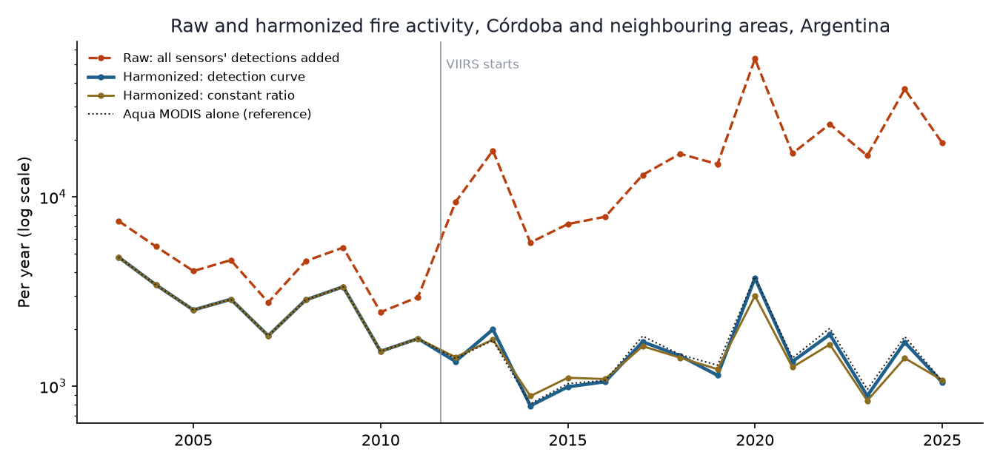

<!-- AI-assisted: written with help from Claude (Anthropic). Reviewed by: Mahabu Subhani (pending). -->

# Fire Census

**One fire record, whichever satellite was watching.**

NASA Space Apps Challenge 2026, challenge *Harmonization of MODIS and VIIRS Hot Spots*.
Team Sharmaji Ka Satellite, Bangalore.

**Live app: https://mahabu-subhani.github.io/fire-census/**



## The problem

NASA satellites have recorded fires since 2000. In 2012 a sharper sensor,
VIIRS, joined the older MODIS, and the raw hotspot count jumps about fivefold
overnight. The jump is the camera, not the fire, so 2005 and 2025 cannot be
compared.

## What Fire Census does

It rebuilds the NASA FIRMS record into one burning calendar in which every
year means the same thing, and shows it in a web app that needs no account.

- **Burning calendar**: every month from 2000 to today, one row per year.
- **Is this month unusual?** The current month ranked against the same days in every earlier year.
- **Area and dates**: draw a rectangle or polygon, type coordinates, or search a district; pick any date range.
- **Raw or harmonized**: one switch shows the 2012 jump appear and disappear.
- **Downloads**: every chart as CSV, PNG and SVG, and the hotspots behind a search as CSV.

Four regions are processed: Córdoba and Chilecito (Argentina), Punjab and
Haryana, and south Karnataka's forests (India). Selection works inside these
regions, not worldwide.

## How it works

1. **Count each place once.** One fire fills several VIIRS pixels, so
   detections are counted per 1 km grid square per satellite pass.
2. **Count the fires above a measured cut-off.** Where Aqua MODIS and VIIRS
   passed on the same day, we measured how often MODIS also reported a fire
   VIIRS saw, at each fire strength. From 2012 the record counts the VIIRS
   fire cells at or above the midpoint of that curve (the hard floor). The
   curve does not weight that count; it weights the small-fire layer.
3. **One conversion constant per calendar month.** How much MODIS misses
   changes with the season, so the count is scaled by a constant fitted for
   each calendar month. Our own held-out check found this (see below).

| Step at 2012 (1.0 = no jump) | Córdoba | Punjab and Haryana |
|---|---|---|
| Raw record | about 5.2× | about 5.3× |
| After harmonization | 1.08× | 0.98× |

## How we tested it, including what failed

Ten checks and their limits were written down before the data was analysed
([docs/PREREGISTRATION.md](docs/PREREGISTRATION.md)). All results are shown in the app.

- **Passed in Córdoba and in Punjab and Haryana:** no step at 2012, no step
  at a date with no sensor change, and NOAA-20 (never used for fitting)
  reproduces the record (Córdoba: slope 0.938, correlation 0.977).
- **The month-by-month held-out check failed first, and it was right.** With
  one year-round constant it failed in both areas (0.207 and 0.169 against
  0.15). The error followed the season: in Punjab and Haryana, May read about
  75 percent too high after 2012 and October about 20 percent too low, in the
  fitting years and the held-out years alike. With one constant per calendar
  month the check passes: 0.117 in Córdoba, 0.148 in Punjab and Haryana.
- **That pass is not a clean one, and we say so.** The method was changed
  after the failure was seen. On two further years whose monthly values had
  not been looked at (2020 to 2021, check C3x, added afterwards) Córdoba
  passes (0.124) and **Punjab and Haryana fails** (0.169); there the first
  check is at the limit (0.148 against 0.15). Under five other reasonable settings
  the month-by-month check fails in three of five in Córdoba and in all five
  in Punjab and Haryana.
- **Caveat on the 2012 check:** the fitted constants overlap the test window.
  Refitted without those years (check C1x, added afterwards and labelled so)
  the step is 0.072 in Córdoba, against a limit of 0.10.
- **Failed:** the comparison with burned area in Córdoba (ESA and NASA
  products). Aqua alone fails it the same way, so it is not the sensor change.
- **Weaker regions:** Chilecito borrows Córdoba's calibration and Karnataka
  ships the fallback ratio; both fail several checks and are labelled in the
  app.

Full limits: [submission/limits.md](submission/limits.md).

## Run it

App (Node 20 or newer):

```bash
cd app && npm install && npm run dev
```

Tests: `npm test` in `app/`.

**Check our numbers yourself, from this repository alone.** Every detection we
used ships with the app, so the method can be rerun with no NASA account and
no download (Python 3.11 or newer, about 15 minutes):

```bash
pip install duckdb pandas pyarrow numpy scipy scikit-learn pytest
```

```bash
cd pipeline && python from_hotspots.py && python harmonize.py && python validate.py && python loyo.py
```

`validate.py` prints every check for every method; they match the Checks panel
in the app. Rebuilding from the original FIRMS archive files, and the tests:
[pipeline/README.md](pipeline/README.md).

## Team

| Person | Role |
|---|---|
| Mahabu Subhani | Data, science, technical writing |
| 8crsk | App foundation, map, controls |
| Charulekha Rajesh | Charts, demo, submission |

## Use of AI

Most of the code and documentation in this repository was written with Claude
(Anthropic), directed and reviewed by the team. Details: [docs/AI_USE.md](docs/AI_USE.md).

## Data and licence

Apache 2.0. We acknowledge the use of data from NASA's Fire Information for
Resource Management System (FIRMS), part of NASA LANCE. Also used: MYD14A1
(NASA LP DAAC), ESA Fire_cci v5.1, ESA WorldCover 2021. Full references:
[docs/REFERENCES.md](docs/REFERENCES.md).
